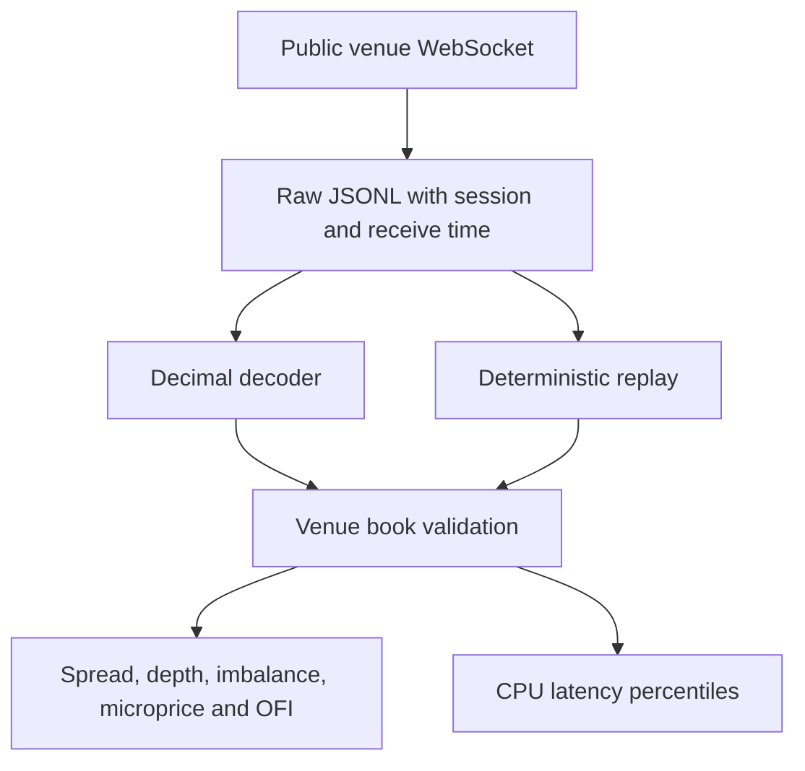

# BTC microstructure: first vertical slice

## Audit and priority
Main at c566725 has FastAPI/Postgres, collectors, fair values, historical paper
simulation and a Next.js dashboard. No BTC L2 engine or CI workflow exists there.
No open PRs or other branches were present at inspection. Existing sportsbook
logic remains separate and is not evidence of an Ontario-accessible instrument.

| Priority | Change | Impact | Effort / dependency |
|---|---|---|---|
| 1 | Decimal L2, strict validation, raw recorder, replay | High | Implemented here; live verification pending |
| 2 | Longer real captures, independent CRC fixtures, fault injection | High | Feed access and running tests |
| 3 | Python vs Rust/C++ parity benchmark | High | Stable corpus; not implemented |
| 4 | Purged walk-forward calibrated baselines, 5/15/60-minute labels | High | Sufficient real history; not implemented |
| 5 | Cost-aware event simulator and dashboard | High | Valid signals and execution assumptions |
| 6 | Exact prediction-contract verification and fair value | Conditional | Brokerage evidence and settlement metadata |

## Run
From repository root:
```bash
pip install -r backend/requirements.txt -r backend/requirements-microstructure.txt
python -m pytest backend/tests -q
cd backend
python -m app.microstructure.replay tests/fixtures/btc_coinbase_synthetic.jsonl --venue coinbase
python -m app.microstructure.capture --venue kraken --output kraken.jsonl --seconds 60
python -m app.microstructure.replay kraken.jsonl --venue kraken
python -m app.microstructure.capture --venue coinbase --output coinbase.jsonl --seconds 60
```
Fixture prices are invented software-test inputs, never historical prices.
The recorder exclusively creates its output, prints validated features, stores raw
trade messages as well as books and preserves receive time and exchange timestamps
inside raw messages. It reconnects after timeout or invalid state and requests
a new snapshot. Corrupt raw events remain in the audit log: strict replay rejects
them rather than concealing a capture defect. Split reviewed valid sessions for
research; automatic corrupt-session quarantine is future work.

## Architecture


Kraken v2 validates CRC32 after every full message and truncates at subscription
depth; precision is preserved before checksum construction. Coinbase Exchange
uses public level2_batch (batched delivery), keeps the full received book, and has
neither a book checksum nor contiguous L2 sequence field. We do not fabricate
sequence validation or use trade sequence gaps as L2 gaps. Transport reconnect,
staleness and malformed/crossed state invalidate books. Silent Coinbase
upstream omissions cannot be independently detected by this implementation.
Reference: https://docs.kraken.com/api/docs/guides/spot-ws-book-v2 and
https://docs.cdp.coinbase.com/exchange/websocket-feed/channels .

OFI is the change in best-quote supply/demand between emitted book events.
Call features once per accepted event; it advances the OFI reference.
Depth sums use the configured top N. Decimal arithmetic favors correctness;
sorting and dictionary copies/updates are not an optimized matching engine.

## Evidence and limits
Replay produces a deterministic feature SHA256 and measured p50/p95/p99
decode/book/feature/total CPU times. File reading, JSONL envelope parsing, network,
exchange batching, disk writes and decisions are excluded. A two-event fixture
is a smoke test, not a defensible speed claim. No benchmark numbers are asserted
until an actual runner result is inspected. No local runtime was available during
authoring; PR CI is the executable verification path.

No normalized trade-flow/realized-volatility feature pipeline, model training,
calibration, statistical signal-decay study, C++/Rust comparison, event-driven BTC
paper simulator or BTC dashboard is implemented yet. No predictive or profitable
performance is claimed. Existing prediction-market simulations are not BTC results.

## Instrument boundary
The verified instrument universe is currently EMPTY. Public market-data access
does not establish Canadian broker access or user eligibility. No exact
Wealthsimple Predict contract has been verified. A later registry must record
contract ID, user eligibility evidence/date, strike, expiry/timezone, settlement
rules, reference index, currency, executable bid/ask and size, fees and FX costs.
Unverified/expired entries must remain disabled. Never substitute a Kalshi or
Polymarket listing. No Wealthsimple API capability is assumed; this module has no
order endpoint, private credentials, wallet, or live-execution interface.

## Resume-safe descriptions (code capabilities; validation pending CI)
- Implemented Decimal-based BTC L2 reconstruction with Kraken CRC validation and fail-closed book handling.
- Added raw WebSocket capture and deterministic replay with feature-output hashes and staged CPU latency instrumentation.
- Added regression coverage for malformed, crossed, stale and pre-snapshot books while preserving the existing research application.
